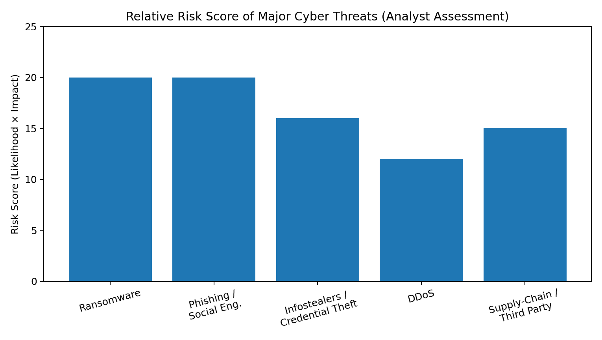
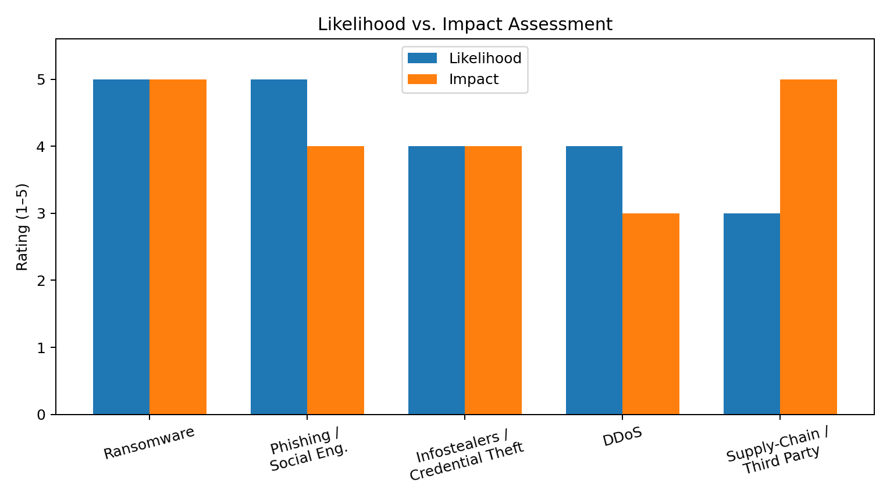

# Week 1 — Cyber Threat Landscape Analysis & Strategic Planning


> A structured review of common cyber threats, qualitative organizational risk, and practical security-planning priorities.

## Executive Summary

This Week 1 internship assignment examines the cyber threat landscape and translates the findings into a practical cybersecurity improvement plan. It covers five threat categories, applies a qualitative 5×5 likelihood-and-impact model, and proposes defensive controls, a phased roadmap, and security performance indicators.

The assessment is educational. Its risk ratings are analyst-assigned examples for this exercise, not measured probabilities or a risk assessment of a named organization.

## Contents

- [Objectives](#objectives)
- [Scope and approach](#scope-and-approach)
- [Threat assessment](#threat-assessment)
- [Risk scoring methodology](#risk-scoring-methodology)
- [Strategic security roadmap](#strategic-security-roadmap)
- [Security KPIs](#security-kpis)
- [Repository contents](#repository-contents)
- [References](#references)
- [Learning outcomes](#learning-outcomes)
- [Ethical and legal scope](#ethical-and-legal-scope)

## Objectives

- Review major and emerging cyber threat categories.
- Consider likelihood, business impact, and organizational exposure.
- Identify common weaknesses associated with each threat.
- Recommend preventive, detective, response, and recovery controls.
- Prioritize improvements through a phased roadmap.
- Identify measurable indicators for ongoing security oversight.

## Scope and Approach

The analysis is organized around five threat categories:

1. Ransomware and double extortion
2. Phishing and social engineering
3. Infostealers and credential theft
4. Distributed denial-of-service (DDoS)
5. Supply-chain and third-party compromise

**Workflow:** threat research → threat characterization → qualitative risk rating → defensive controls → improvement roadmap → KPIs.

The supporting report and source list are included in this repository. The assessment should be revisited when the environment, threat intelligence, or business priorities change.

## Threat Assessment

| Threat category | Likelihood | Impact | Risk score | Priority |
|---|---:|---:|---:|---|
| Ransomware / Double Extortion | 5/5 | 5/5 | **25** | Critical |
| Phishing / Social Engineering | 5/5 | 4/5 | **20** | Critical |
| Infostealers / Credential Theft | 4/5 | 4/5 | **16** | Critical |
| Supply-Chain / Third-Party Compromise | 3/5 | 5/5 | **15** | High |
| DDoS / Service Disruption | 4/5 | 3/5 | **12** | High |

**Calculation correction:** the ransomware score is 5 × 5 = **25**, not 20. The remaining scores follow the same likelihood × impact formula.

### Risk visuals





### Threat themes and defensive controls

| Threat | Main concern examined | Defensive controls proposed |
|---|---|---|
| Ransomware | Service disruption, extortion, and recovery pressure | MFA, network segmentation, endpoint protection, patching, isolated/immutable backups, and restoration exercises |
| Phishing / Social Engineering | Credential theft, impersonation, and business email compromise | Phishing-resistant MFA, email authentication and filtering, awareness training, and out-of-band verification |
| Infostealers / Credential Theft | Theft of browser credentials, cookies, and session tokens | Endpoint protection, browser hardening, password managers, unique credentials, and session revocation |
| DDoS | Loss of network or application availability | Upstream DDoS protection, rate limiting, traffic monitoring, redundancy, and tested response procedures |
| Supply-chain compromise | Risk introduced through vendors, SaaS, dependencies, and CI/CD | Vendor risk review, dependency verification, SBOM practices, least-privilege vendor access, and secure CI/CD controls |

## Risk Scoring Methodology

**Risk score = Likelihood × Impact**

Each factor is rated from 1 (lowest) to 5 (highest).

| Score | Classification |
|---:|---|
| 1–4 | Low |
| 5–9 | Moderate |
| 10–15 | High |
| 16–25 | Critical |

These are the classification bands used in this educational exercise. Ratings are illustrative and should be recalibrated using organization-specific assets, control maturity, threat information, and business impact.

## Strategic Security Roadmap

### Phase 1 — Immediate Actions (0–30 days)

- Inventory internet-facing assets and privileged accounts.
- Enforce MFA on critical accounts.
- Prioritize patching of critical exposed vulnerabilities.
- Validate backup isolation and restoration.
- Review endpoint protection and security logging.
- Establish incident-response contacts and escalation paths.

### Phase 2 — Stabilization (31–90 days)

- Improve network segmentation.
- Define vulnerability-management remediation expectations.
- Strengthen email security.
- Establish third-party risk reviews.
- Conduct security-awareness training.
- Define baseline security metrics.

### Phase 3 — Maturity (3–6 months)

- Improve SIEM monitoring and detection engineering.
- Incorporate relevant threat intelligence.
- Maintain an SBOM for critical applications.
- Harden CI/CD pipelines and secrets management.
- Conduct incident-response tabletop exercises.
- Test disaster-recovery procedures.

### Phase 4 — Continuous Improvement (6–12 months)

- Monitor security-control effectiveness.
- Conduct authorized security testing.
- Review privileged and vendor access.
- Update threat models as technology changes.
- Use incidents and near misses to improve safeguards.

## Security KPIs

The report proposes tracking the following indicators. No performance values or targets are asserted in this README.

| KPI | What it helps monitor |
|---|---|
| Critical vulnerability remediation time | Timeliness of addressing critical exposure |
| MFA coverage | Adoption of stronger authentication |
| Backup restoration success | Recoverability of protected data |
| MTTD | Mean Time to Detect |
| MTTR | Mean Time to Respond |
| Security-awareness completion | Completion of awareness activities |
| Critical vendor assessment coverage | Coverage of third-party risk reviews |
| DDoS response readiness | Preparedness for availability incidents |

Targets should be set after a baseline is established and business requirements are understood.

## Repository Contents

```text
week-1-cyber-threat-landscape-analysis/
├── README.md
├── report/
│   └── Week_1_Cyber_Threat_Landscape_Analysis_2026.docx
├── charts/
│   ├── threat-risk-matrix.png
│   └── threat-comparison.png
└── references/
    └── sources.md
```

- **Report:** detailed assignment write-up.
- **Charts:** risk matrix and threat comparison visuals.
- **References:** source links used to support the research.

## References

See [references/sources.md](references/sources.md) for the source list, including ENISA, Verizon, Microsoft, Cloudflare, IBM, and Palo Alto Networks Unit 42 materials selected for this assignment.

## Learning Outcomes

- Categorizing common cyber threats.
- Applying a qualitative likelihood-and-impact model.
- Explaining defensive security controls.
- Organizing improvements into a phased roadmap.
- Selecting security indicators for ongoing review.

## Ethical and Legal Scope

This is an **educational and defensive cybersecurity analysis**. It does not document unauthorized scanning, exploitation, credential theft, persistence, malware deployment, or access to systems without permission. Any real-world assessment must have clear authorization and an agreed scope.

---

**Author:** Injmam Ansari  
BCA Student | Cybersecurity Intern

*Week 1 internship documentation — Cyber Threat Landscape Analysis & Strategic Planning.*
